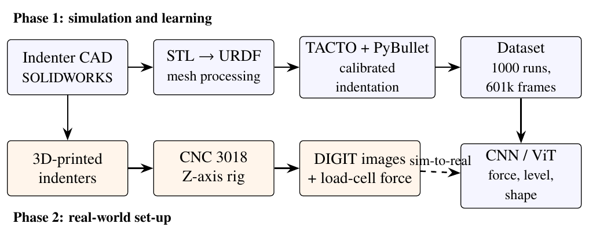
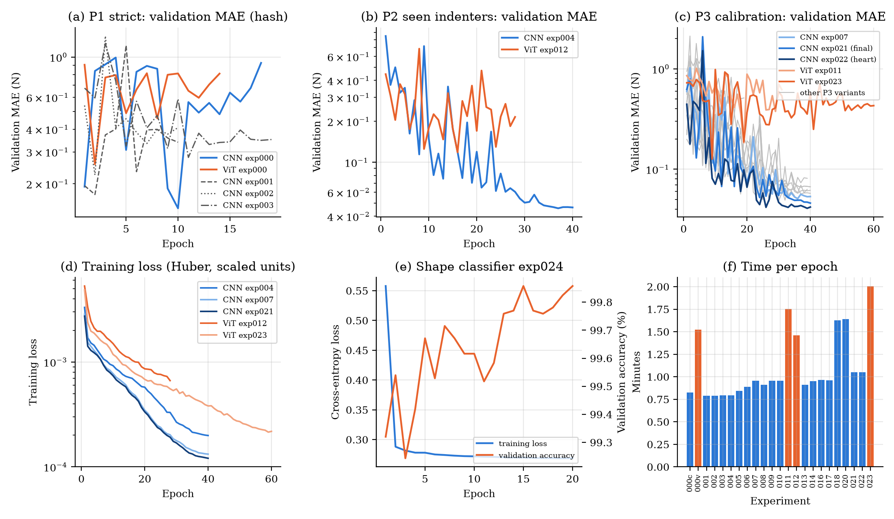

# Vision-Based-Tactile-Sensor

Force estimation from vision-based tactile sensor (VBTS) images with deep learning: a CNN and a Vision
Transformer (ViT) that read the contact force (N), the force level and the indenter shape from single
DIGIT tactile frames.

The work has two phases:

| Phase | What | Where |
|---|---|---|
| **1 – Simulation and learning** | 8 indenters designed in SOLIDWORKS → STL → URDF, pressed into a DIGIT sensor simulated in TACTO/PyBullet along calibrated force profiles; 1000 runs, 601,000 labelled frames; CNN and ViT trained for force regression, force-level and shape classification | `data_generation/`, `tactile_force/`, `experiments/` |
| **2 – Real-world set-up** | CNC 3018 Z-axis indentation rig, 3 kg YZC-131 load cell + HX711 + ESP32 for the ground-truth force, synchronised DIGIT + load-cell recording; hemispherical main indenter | `real_rig/`, `cad/` |



This repository accompanies the M.Tech thesis *Design and Analysis of a Vision-Based Tactile Sensor (VBTS)
Calibration Setup through Machine Learning Techniques* (Vijay Hemanth T, UVCE; work carried out at
CSIR-NIDSA, Bengaluru).

## Results at a glance

Test indenter: **hexagonal** – all 125 runs in P1, the 115 runs not used for calibration in P3 (68,515 frames, 39,935
in contact); P2 tests on 15 % of the runs of all indenters. "Contact" = frames with force > 0.05 N. Full tables in [docs/experiments.md](docs/experiments.md) and [docs/results.md](docs/results.md).

| Setting | Model | Contact MAE (N) | Contact R² | All-frame MAE (N) |
|---|---|---|---|---|
| P1 – strict unseen indenter (exp000) | CNN | 2.014 | −1.118 | 1.178 |
| P1 – strict unseen indenter (exp000) | ViT | 2.721 | −3.500 | 1.586 |
| P2 – seen indenters, unseen runs (exp004 / exp012) | CNN / ViT | 0.083 / 0.208 | 0.993 / 0.953 | 0.048 / 0.121 |
| P3 – few-shot calibration, 5 runs of the new indenter (exp007) | CNN | 0.096 | 0.992 | 0.056 |
| **P3 – final recipe, 30-frame mean reference (exp021)** | **CNN** | **0.078** | **0.995** | **0.046** |
| P3 – final recipe (exp023) | ViT | 0.805 | 0.574 | 0.470 |
| exp021 + flip-TTA + causal 3-frame mean (real-time) | CNN | 0.059 | 0.997 | 0.035 |
| exp021 + flip-TTA + centred 25-frame median (offline) | CNN | **0.043** | **0.9985** | **0.025** |

| Task | Result |
|---|---|
| Force-level classification (from the exp021 regressor) | frame accuracy 97.6 % (98.6 % with smoothing), **run-level peak force 115/115 correct** (peak MAE 0.055 N) |
| Indenter-shape classification, 8 classes (exp024, CNN) | **99.7 % frame accuracy**, macro-F1 0.997, 152/152 test runs correct |
| Same recipe on another new indenter (heart, exp022) | contact MAE 0.074 N, R² 0.995 |
| Phase 2 – first real frames (hemisphere, 0/200/250 mN) | imprint grows from 7,642 to 13,517 px between 200 and 250 mN; real image noise ≈ ½ of the simulated noise |

Key findings:

1. **Absolute force on a never-seen indenter is not identifiable** from TACTO images: the difference image of
   flat-faced indenters saturates at ≈ 0.5–1 N and the saturation level depends on the shape, so both
   networks fail in the strict setting (worse than predicting a constant).
2. **With shape knowledge the images are highly informative**, and **five labelled calibration runs** of the
   new indenter (one per force level) are enough to reach the seen-indenter accuracy.
3. **Rendering noise is the remaining error source**: averaging the no-contact reference over the first 30
   frames and smoothing the predictions in time reduce the error from 0.096 N to 0.043 N.
4. The **CNN beats the ViT** (no pre-training) in every setting.



## Repository layout

```
├── main.py                    CLI: index | inspect | checklabels | train | evaluate | predict | compare | all
├── run_split_experiment.py    one-command strict unseen-indenter experiment (exp000, CNN + ViT)
├── tactile_force/             learning pipeline (indexing, splits, preprocessing, models, training, metrics, plots)
├── configs/                   YAML configs (default, cnn, vit, split_hex_hash, unseen_shapes)
├── experiments/               numbered experiment runner, TTA/ensembles/smoothing, force-level and shape classification, studies, queue scripts
├── data_generation/           Phase 1: TACTO/PyBullet dataset generator, force profiles, exploratory PID generator + sweep
├── real_rig/                  Phase 2: synchronised DIGIT + load-cell recording (record_both_sensors.py, config.yaml)
├── analysis/                  scripts that produce the thesis figures
├── cad/                       SOLIDWORKS parts of the 8 indenters + renders (incl. the Phase-2 hemisphere)
├── checkpoints/               released models: exp021 force CNN, exp024 shape classifier
├── results/                   metrics, configs, histories and plots of every experiment (exp000–exp024), dataset logs
├── tests/                     pytest suite on a synthetic dataset
├── tools/                     synthetic dataset generator
└── docs/                      documentation (see below)
```

## Quick start

```bash
git clone https://github.com/VHemanth18/Vision-Based-Tactile-Sensor.git
cd Vision-Based-Tactile-Sensor
python -m venv .venv && source .venv/bin/activate        # Windows: .\.venv\Scripts\Activate.ps1
# install PyTorch for your GPU first: https://pytorch.org/get-started/locally/
pip install -r requirements.txt
python -m pytest -q                                       # 9 passed

# predict the force of every frame of one run with the released final model
python main.py predict --config checkpoints/exp021_cnn_force_final.yaml \
    --ckpt checkpoints/exp021_cnn_force_final.pt \
    --input /path/to/TACTO_DATASETS/hexagonal_indenter/force_3N/duration_20s/sigmoid/frames --out pred.csv

# reproduce the final recipe (needs the dataset)
export TACTO_DATA_ROOT=/path/to/TACTO_DATASETS
python run_split_experiment.py --data-root $TACTO_DATA_ROOT          # exp000 + the shared frame index
python experiments/run_exp.py --name cnn_cal5v5_hex_ref30_last --model cnn --val none --set \
  split.calib_runs_per_force=1 split.calib_val_runs_per_force=1 train.oversample_factor=10 \
  "train.oversample_shapes=[hexagonal_indenter]" train.early_stop_patience=999 train.select=last preprocess.ref_frames=30
```

## Documentation

| Document | Contents |
|---|---|
| [docs/installation.md](docs/installation.md) | environments for learning, simulation and the rig; Windows, Linux, Colab |
| [docs/project_overview.md](docs/project_overview.md) | the two phases, research questions, evaluation protocols P1–P3 |
| [docs/phase1_simulation.md](docs/phase1_simulation.md) | indenters, CAD → STL → URDF, TACTO set-up, force-controlled indentation, profiles |
| [docs/dataset_preparation.md](docs/dataset_preparation.md) | generating the dataset, folder layout, label CSV, indexing and checks |
| [docs/phase2_real_rig.md](docs/phase2_real_rig.md) | rig hardware, hemispherical main indenter, wiring, recording, first real frames |
| [docs/modules.md](docs/modules.md) | every module and script and what it does |
| [docs/how_to_run.md](docs/how_to_run.md) | all commands: index, train, evaluate, predict, experiments, post-processing, classification, figures |
| [docs/experiments.md](docs/experiments.md) | every experiment exp000–exp024 with settings and metrics |
| [docs/results.md](docs/results.md) | final results with figures, error analysis, CNN vs ViT, classification, Phase 2 |
| [docs/troubleshooting.md](docs/troubleshooting.md) | common problems and fixes |

## Data

The simulated dataset (≈ 31 GB, 601,000 PNG frames) is not stored in this repository. It can be regenerated with
`data_generation/generate_tacto_dataset.py` (see [docs/dataset_preparation.md](docs/dataset_preparation.md)); the
per-indenter force–depth curves and collection logs of the original dataset are in `results/dataset/`.

## Licence

MIT – see [LICENSE](LICENSE). The dataset generator is adapted from the TACTO examples (MIT licence, Facebook, Inc.).
