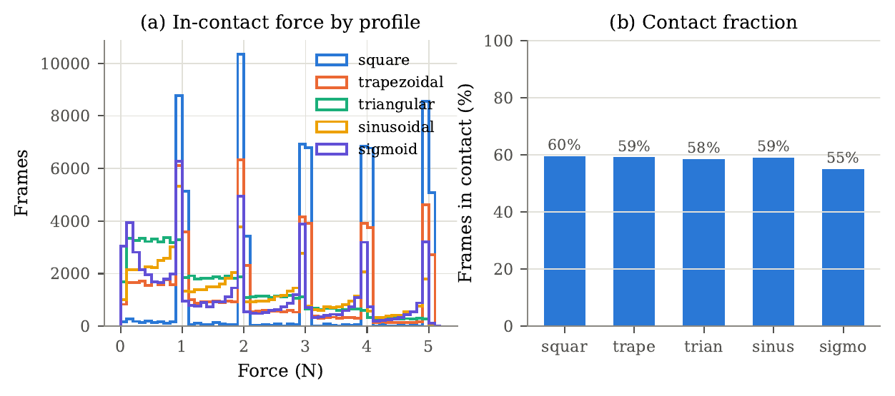

# Dataset preparation

## 1. Generate the simulated dataset

### Files the generator needs

```
data_generation/
├── generate_tacto_dataset.py
├── profiles.py
├── conf/
│   ├── digit.yaml               <- from TACTO examples/conf/ (sensor, digit and object sections) + experiment section below
│   └── bg_digit_240_320.jpg     <- from TACTO examples/conf/
└── objects/
    ├── <name>_indenter.urdf     <- one per indenter (template: indenter_template.urdf)
    └── meshes/<name>_indenter.stl
```

1. Install the simulation requirements ([installation.md](installation.md#2-dataset-generation-phase-1)).
2. Copy `digit.yaml` and `bg_digit_240_320.jpg` from the TACTO repository (`examples/conf/`) into
   `data_generation/conf/`, and the DIGIT URDF/meshes that `digit.yaml` refers to (TACTO `meshes/`).
3. Add an `experiment` section to `conf/digit.yaml`:

   ```yaml
   experiment:
     out_root: /path/to/TACTO_DATASETS
     shapes: [asterisk_indenter, ball_array_indenter, hash_indenter, heart_indenter,
              hexagonal_indenter, ring_indenter, star_indenter, triangle_indenter]
     profiles: [square, trapezoidal, triangular, sinusoidal, sigmoid]
     forces_N: [1, 2, 3, 4, 5]
     durations_s: [10, 15, 20, 25, 30]
     pixel_area_mm2: <area of one depth-image pixel on the gel in mm²>
   ```

   `pixel_area_mm2` converts the number of depth pixels in contact into the contact area (gel width × height /
   number of depth pixels of the TACTO DIGIT model).
4. Export the eight SOLIDWORKS parts (`cad/solidworks/`) to STL and write one URDF per indenter
   ([phase1_simulation.md](phase1_simulation.md#cad--stl--urdf)).
5. Run, one indenter per process if you want to parallelise:

   ```bash
   cd data_generation
   python generate_tacto_dataset.py                                              # all shapes in the config
   python generate_tacto_dataset.py "experiment.shapes=[hash_indenter]"            # one indenter
   python generate_tacto_dataset.py experiment.out_root=/data/TACTO_DATASETS       # other output folder
   ```

One indenter = 125 runs = 75,125 frames. The full dataset is ≈ 31 GB.

### Folder layout produced

```
TACTO_DATASETS/
└── <shape>_indenter/                       asterisk, ball_array, hash, heart, hexagonal, ring, star, triangle
    ├── force_depth_curve.csv               F = φ(δ) on 0–3 mm (calibration of this indenter)
    ├── collection_log.csv                  one row per run with the tracking metrics
    └── force_<F>N/duration_<T>s/<profile>/  F ∈ 1..5, T ∈ 10,15,20,25,30, 5 profiles
        ├── frames/frame_00001.png …        one PNG per rendered frame (30 fps); T·30 + 1 frames
        ├── force_depth_calibration.csv     label row per frame
        ├── summary.json                    rmse_N, max_abs_err_N, overshoot_pct, hold_ripple_N, peak_measured_N
        ├── force_plot.png                  commanded vs measured force
        └── video.mp4
```

### Label file `force_depth_calibration.csv`

| Column | Meaning |
|---|---|
| `time_s` | time since the start of the run (s) |
| `frame` | frame number = number in `frame_NNNNN.png` (1-based) |
| `phase` | `idle`, `pressing`, `holding` or `releasing` (from the slope of the commanded force) |
| `target_force_N` | commanded force F*(t) |
| `measured_force_N` | normal contact force from PyBullet (**the training label**) |
| `z_height_m` | indenter height |
| `indentation_mm` | commanded indentation δ (−0.3 = hovering above the gel) |
| `max_penetration_mm` | maximum gel penetration from the TACTO depth image |
| `contact_area_mm2` | contact area from the TACTO depth image |

The `collection_log.csv` and `force_depth_curve.csv` of the original dataset are in `results/dataset/`.

## 2. Index the dataset for learning

The learning pipeline reads the dataset through a per-frame **index** (`index.csv`): one row per frame with the run
metadata parsed from the path (shape, peak force, duration, profile), the frame number, the time and the force label.

```bash
python main.py index data.root=/path/to/TACTO_DATASETS                    # -> outputs/index/index.csv, coverage.txt
python main.py checklabels data.root=/path/to/TACTO_DATASETS              # do labels follow the visible contact?
python main.py inspect data.root=/path/to/TACTO_DATASETS                  # raw frame vs network input -> inspect.png
```

`run_split_experiment.py` builds its own index in `outputs/split_test-hexagonal_val-hash/index/`;
`experiments/run_exp.py` copies that index once to `outputs/experiments/_index/index.csv` and shares it between
all numbered experiments.

Label alignment (in `tactile_force/indexing.py`), in order of preference:

1. the CSV has a frame column → join on the frame number (the case for this dataset),
2. the CSV has render rows → n-th rendered row = frame n,
3. the CSV has a time column → interpolate the force at the frame time,
4. otherwise rows are assumed evenly spaced over the run; without any CSV the commanded profile is used
   (`data.allow_target_fallback`).

Supported layouts: `<shape>/force_<F>N/duration_<T>s/<profile>/frames/*.png` (this dataset) and
`<shape>/<profile>/<F>N_<T>s/frames/*.png` (exploratory PID generator).

## 3. Check the dataset

Read `coverage.txt` in the index folder:

* `no_frames_dir` / `empty_frames_dir`: the run has no frames;
* `label_error`: the CSV could not be used (its columns are listed); set `data.force_column=<name>` if the force column has an unusual name;
* every run must start at 0 N (no contact): the input is the difference to the first (no-contact) frames.

Dataset statistics of the released dataset (`results/dataset_stats.json`): 601,000 frames, 58.3 % in contact
(55.1 % for sigmoid to 59.6 % for square profiles); every run has at least 61 idle frames at the start, which the
30-frame mean reference uses.



## 4. Real-world recordings (Phase 2)

`real_rig/record_both_sensors.py` writes `recording_<timestamp>/digit_frames/*.png`, `digit_log.csv`
(`timestamp_epoch, timestamp_iso, frame_idx, image_file, weight_g_interp`) and `loadcell_log.csv`
(`timestamp_epoch, timestamp_iso, weight_g, raw_line`). To train or evaluate on it, arrange each recording as a run
folder (`<shape>/force_<F>N/duration_<T>s/<profile>/frames/` with a label CSV containing `frame` and the force in
newtons, i.e. `weight_g_interp × 9.81 / 1000`) and index it like the simulated data. See
[phase2_real_rig.md](phase2_real_rig.md).
