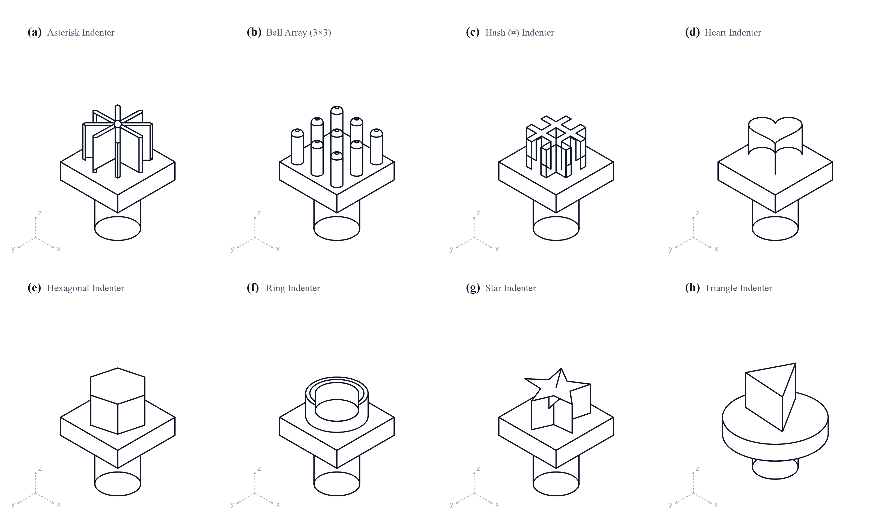
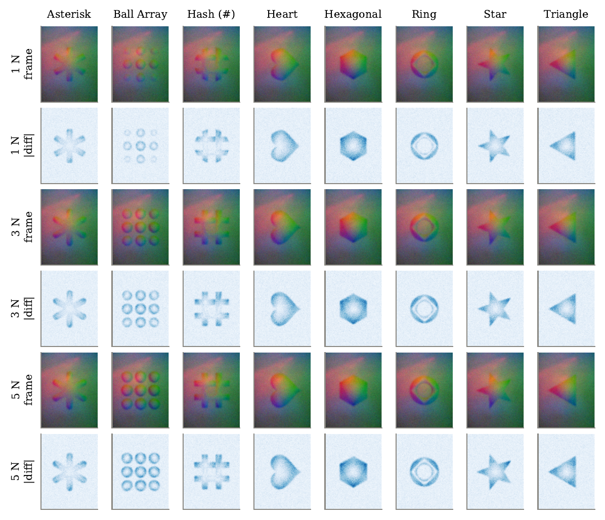
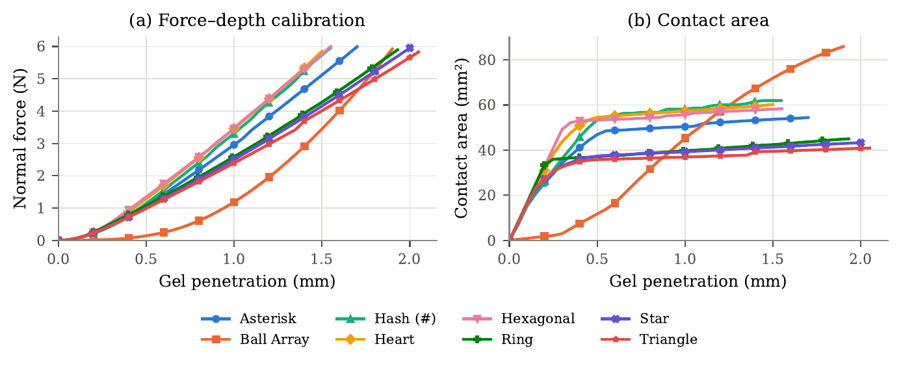
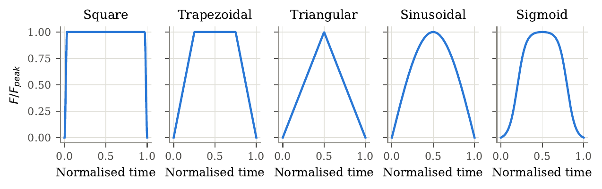

# Phase 1 – Tactile sensor simulation

## Indenters

| Indenter | Contact feature | Role |
|---|---|---|
| asterisk | thin radial ribs | training |
| ball_array | 3 × 3 array of domed pins (Hertz-like contacts) | training |
| hash (#) | two pairs of crossing ribs | training; **validation indenter in P1** |
| heart | smooth lobes, a notch and a point | training; second test indenter (exp010, exp022) |
| hexagonal | hexagonal prism (closest to a flat circular punch) | **test indenter** |
| ring | annulus (inner and outer edge) | training |
| star | prism with re-entrant corners | training |
| triangle | prism with sharp corners, smallest convex face | training |

Each indenter is a single SOLIDWORKS solid (`cad/solidworks/*.SLDPRT`): a contact feature on a base plate with a
cylindrical shank on the actuator axis, so the force acts along the sensor normal with no moment.

## CAD → STL → URDF

1. Export each part from SOLIDWORKS as STL (binary, millimetres).
2. Write a single-link URDF whose visual and collision geometry both refer to the STL, with `scale="0.001 0.001 0.001"`
   (mm → m). A template is in [`data_generation/objects/indenter_template.urdf`](../data_generation/objects/indenter_template.urdf).
3. Save it as `data_generation/objects/<name>_indenter.urdf` (e.g. `hexagonal_indenter.urdf`) with the mesh in
   `data_generation/objects/meshes/`.

The conversion is verified in the simulation: every indenter gives a smooth, monotonic force–depth curve on 0–3 mm
and an imprint centred in the image with the expected outline.

## Simulated sensor

| Parameter | Value |
|---|---|
| Sensor model | TACTO DIGIT (`conf/digit.yaml` from the TACTO examples), background `bg_digit_240_320.jpg` |
| Rendered frame | 120 × 160 pixels (width × height, portrait), RGB, saved as 8-bit PNG |
| Frame rate | 30 fps (one rendered frame every 1/30 s) |
| Physics | PyBullet, 240 Hz time step, 400 solver iterations, 10 settling steps after each pose change |
| Indenter pose | centred over the gel (x = −0.022 m, y = 0), fixed orientation; only z is commanded |
| Idle height | 0.3 mm above the gel |

## Force-controlled indentation

For every indenter `generate_tacto_dataset.py`

1. finds the contact height z₀ (first contact between indenter and gel),
2. records the **force–depth curve** F = φ(δ) in 0.05 mm steps on 0–3 mm (`force_depth_curve.csv`: depth, force,
   contact area, maximum penetration, z),
3. for each run converts the commanded force F*(t) into a depth command δ*(t) = φ⁻¹(F*(t)) and moves the indenter to
   z(t) = z₀ − δ*(t) (**feed-forward depth control**); frames with F* = 0 hold the indenter 0.3 mm above the gel,
4. saves each rendered frame with its label row and writes a summary with the tracking metrics.

Simulated contact characteristics (from `results/dataset/<indenter>/force_depth_curve.csv` and `collection_log.csv`):

| Indenter | F at 3 mm (N) | Max. contact area (mm²) | Depth at 1 N (mm) | Depth at 5 N (mm) | Mean tracking RMSE (mN) | Max. tracking error (mN) |
|---|---|---|---|---|---|---|
| asterisk | 12.6 | 61.4 | 0.50 | 1.45 | 2.3 | 51.8 |
| ball_array | 16.6 | 144.4 | 0.95 | 1.75 | 0.9 | 6.3 |
| hash | 14.8 | 74.9 | 0.45 | 1.35 | 5.4 | 51.4 |
| heart | 14.5 | 70.0 | 0.45 | 1.35 | 1.7 | 5.0 |
| hexagonal | 14.2 | 67.9 | 0.40 | 1.35 | 2.8 | 32.2 |
| ring | 10.5 | 52.0 | 0.50 | 1.70 | 1.8 | 11.2 |
| star | 10.2 | 48.1 | 0.50 | 1.75 | 1.6 | 6.2 |
| triangle | 9.6 | 45.1 | 0.50 | 1.80 | 4.5 | 98.6 |

The flat-faced indenters reach an almost constant contact area after 0.4–0.6 mm (full face engagement, flat-punch
behaviour); the ball array's area keeps growing as the domed pins sink deeper (Hertz-like). The labels track the
commanded force within a few millinewtons on average.

## Force profiles

Every run has 20 % rest before and after the profile (`pre_rest = post_rest = 0.2`); the profile occupies the middle
60 % of the duration. Defined in `tactile_force/profiles.py` (identical copy in `data_generation/profiles.py`):

| Profile | Shape p(u), u ∈ [0, 1] |
|---|---|
| square | smoothed step (raised-cosine edges of 3 % of the active time) |
| trapezoidal | 25 % ramp up, 50 % hold, 25 % ramp down |
| triangular | 1 − |2u − 1| |
| sinusoidal | sin(πu) |
| sigmoid | difference of two logistic functions (k = 20) at u = 0.2 and 0.8, normalised to [0, 1] |

F*(t) = F_peak · p(u) with F_peak ∈ {1, 2, 3, 4, 5} N and duration ∈ {10, 15, 20, 25, 30} s.

## Exploratory generator (PID)

`data_generation/exploratory/demo_pybullet_digit_force.py` is the earlier version of the generator, which closed a
PID loop on the simulated contact force; `run_full_parameter_sweep.ps1` sweeps it over the same design (8 indenters,
1–5 N, 10–30 s, 5 profiles). Its frames are saved as `[tactile RGB | depth colour map]` with a text overlay; the
learning pipeline reads them with `preprocess.mask_top_px=22 "preprocess.crop=[0,0.5,0,1]"`. The released dataset
was produced with the feed-forward generator `generate_tacto_dataset.py`.
