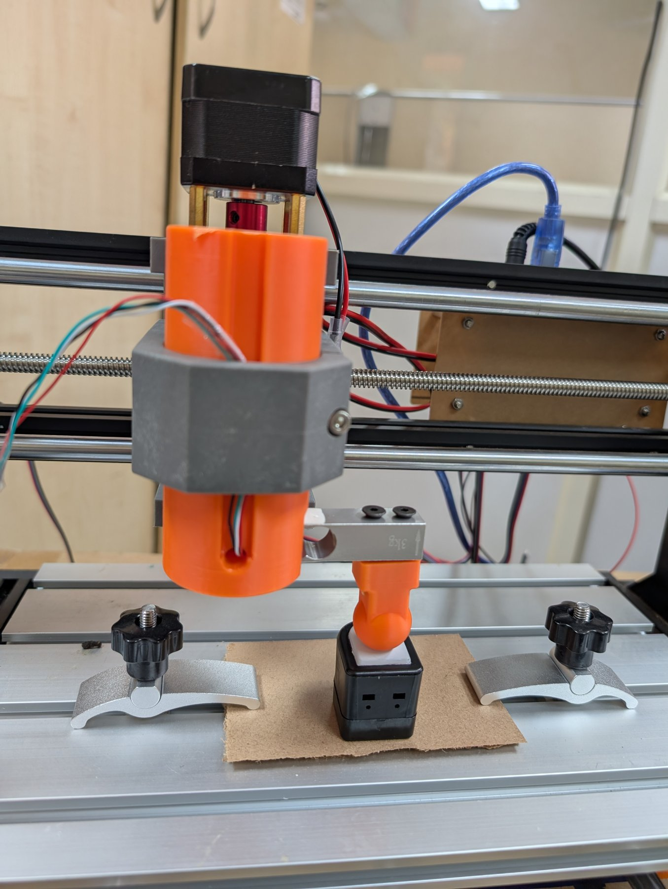
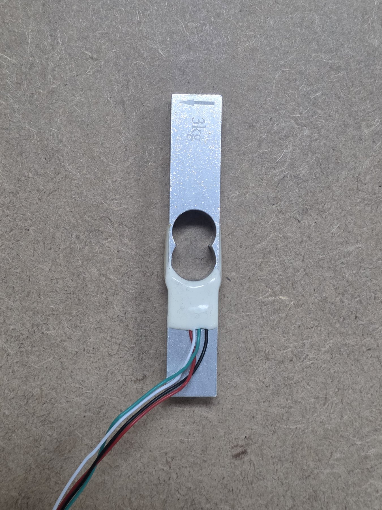
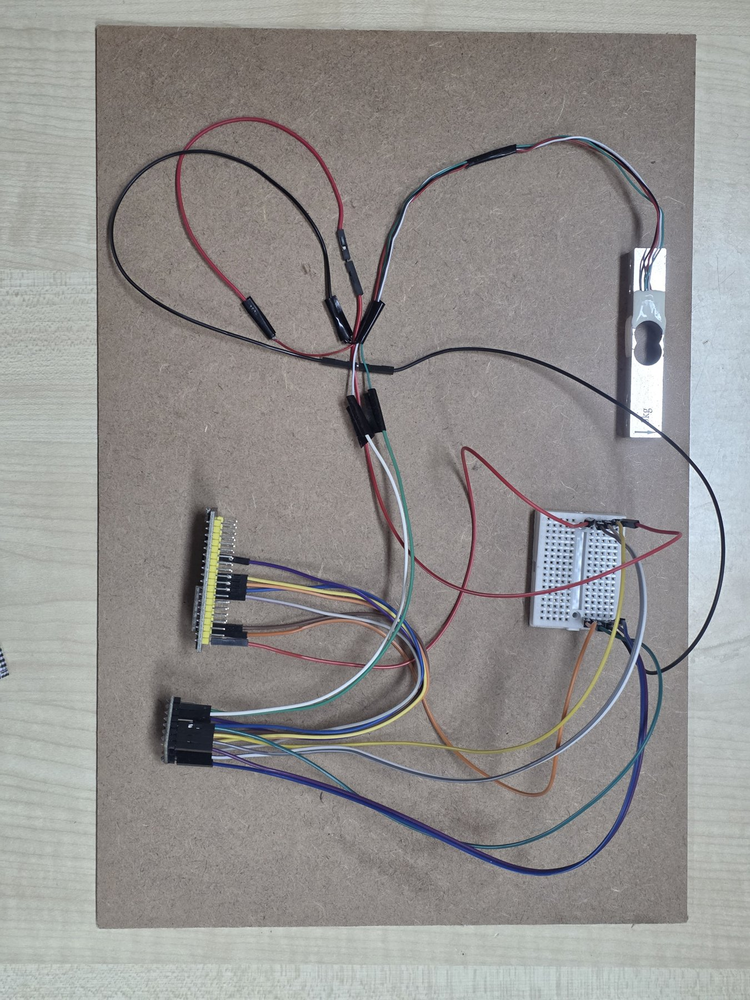
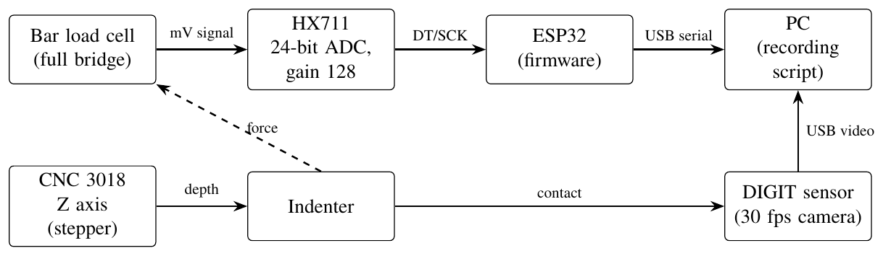
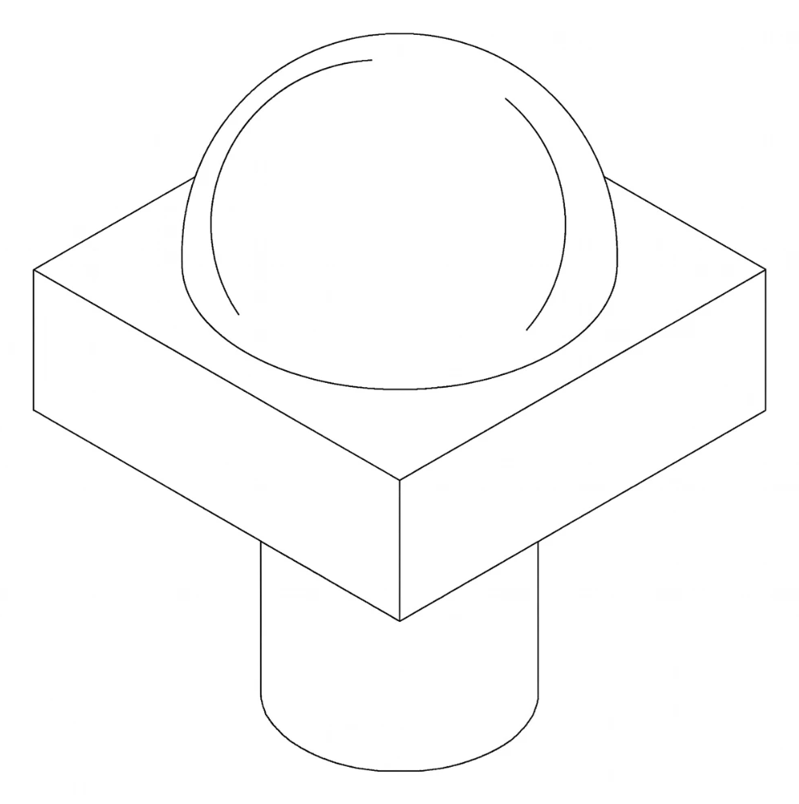
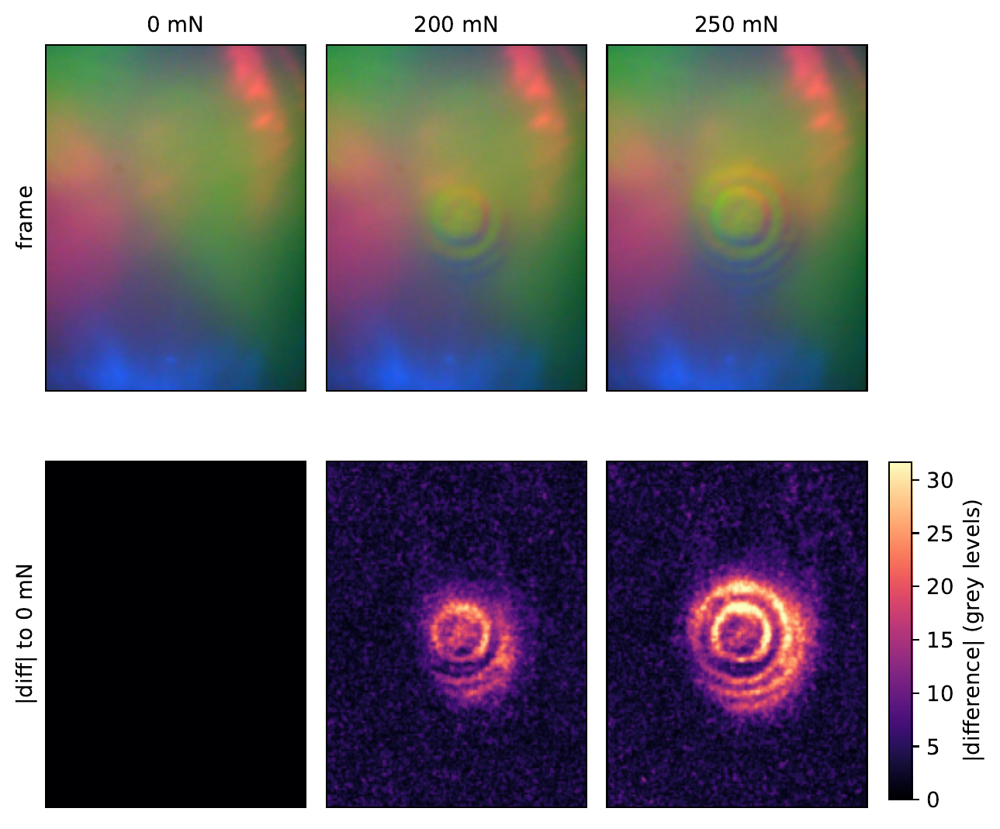

# Phase 2 – Real-world set-up

Phase 2 is the physical counterpart of the simulation: the same indentation experiment on a real DIGIT sensor, with
a load cell measuring the ground-truth force.



## Hardware

| Function | Simulation (Phase 1) | Physical rig (Phase 2) |
|---|---|---|
| Tactile sensor | TACTO DIGIT model, 120 × 160, 30 fps | DIGIT sensor fixed on the machine bed, 240 × 320 (QVGA) |
| Indenter | URDF mesh exported from SOLIDWORKS | 3D-printed indenter on a printed adapter: **hemispherical main indenter**; the eight Phase-1 indenters printed from the same CAD files |
| Normal motion | PyBullet position control of the indenter body | stepper motor driving a lead-screw vertical axis (CNC 3018 frame) |
| Force label | contact force from the physics engine | 3 kg bar load cell (YZC-131) with a 24-bit ADC (HX711) |
| Data | label row per rendered frame | time-stamped load-cell samples and DIGIT frames, frame force by interpolation |

Components:

* **CNC 3018** desktop frame: aluminium extrusion gantry and slotted aluminium bed; the stepper-driven Z axis carries a
  3D-printed vertical-axis housing on two guide rods and a lead screw.
* **Load cell**: 3 kg aluminium bar load cell (parallel-beam, full Wheatstone bridge) mounted as a cantilever in the
  load path between the Z axis and the indenter adapter.
* **HX711** 24-bit ADC (gain 128) and **ESP32** microcontroller (firmware: tare + one-point calibration with a known
  mass, weight streamed over USB serial).
* **DIGIT** sensor on the bed, held by two hold-down clamps, connected to the PC by USB.







## Indenter set: hemisphere as the main indenter



The **hemispherical indenter** is the main indenter of Phase 2. It has the same construction as the Phase-1
indenters (contact feature on a square base plate, cylindrical shank held in the 3D-printed adapter of the rig),
with a curved tip instead of a flat face or pattern. A curved tip gives a single, centred contact whose area grows
smoothly with the load (as for a Hertzian contact) and it is insensitive to a small tilt between indenter and gel,
which a flat face would turn into an uneven, edge-loaded imprint. It is therefore the reference indenter for
commissioning the rig, for the Z-axis and load-cell characterisation and for the first real-time indentation
experiment. The eight Phase-1 indenters are 3D-printed from `cad/solidworks/` for the real dataset. The hemisphere
has no counterpart in the simulated Phase-1 dataset; adding it to the simulation is future work.

## Recording

```bash
pip install -r requirements-rig.txt
cd real_rig
# edit config.yaml: DIGIT serial number, resolution/fps, serial port (or auto), baud rate, known calibration mass
python record_both_sensors.py               # uses real_rig/config.yaml
python record_both_sensors.py my.yaml       # another config
```

1. At start-up the script connects to the ESP32 and, if `loadcell.calibration: true`, guides the tare and the
   one-point calibration with the known mass through prompts in the terminal.
2. A reader thread collects the load-cell lines (`Weight: 123.4 g` or `W:<millis>,<grams>`) with PC time stamps;
   the main loop grabs DIGIT frames and time-stamps them with the same clock.
3. Each frame is assigned the load at its time stamp (`recording.interpolation`: linear, cubic, nearest or last).
4. Press `q` in the preview window (or Ctrl+C) to stop.

Output: `real_rig/recordings/recording_<YYYYmmdd_HHMMSS>/` with `digit_frames/`, `digit_log.csv`
(`timestamp_epoch, timestamp_iso, frame_idx, image_file, weight_g_interp`) and `loadcell_log.csv`
(`timestamp_epoch, timestamp_iso, weight_g, raw_line`). Because both streams share one clock, the (image, force) pairs
have the same form as the simulated dataset (force [N] = `weight_g_interp` × 9.81 / 1000).

## First real-time indentation experiment

The hemispherical indenter was pressed onto the DIGIT gel and a frame was recorded at 0, 200 and 250 mN. The 0 mN
frame is the no-contact reference; the loaded frames are compared with it through the same difference image used by
the learning pipeline.



| Quantity | 0 mN | 200 mN | 250 mN |
|---|---|---|---|
| Role of the frame | reference | loaded | loaded |
| Imprint region (smoothed difference) | – | 7,642 px | 13,517 px |
| Equivalent imprint radius | – | 49 px | 66 px |
| Mean difference inside the imprint (grey levels) | – | 14.2 | 17.0 |
| Peak difference (smoothed) | – | 26.8 | 36.4 |
| Mean difference over the whole frame | 0 | 4.6 | 6.0 |
| Mean difference away from the contact | – | 3.3 | 3.5 |

Observations:

* The set-up works end to end, and the real sensor responds clearly to sub-newton forces.
* The imprint stays at the same position (centre ≈ pixel (135, 165)) and grows concentrically: the Z axis moves the
  indenter along the sensor normal without visible lateral drift.
* Real and simulated images differ in **resolution** (240 × 320 vs 120 × 160), **imprint appearance** (concentric
  bright and dark fringes instead of TACTO's smooth shading) and **noise** (≈ 3 grey levels per frame, about half the
  6.9 of the simulated frames). Models trained in simulation therefore need calibration with real data.

These values come from one frame per force level and are indicative.

## Nominal properties of the force chain

| Quantity | Value | Basis |
|---|---|---|
| Load-cell capacity | 3 kg (29.4 N) | YZC-131 rating |
| Rated output | ≈ 1 mV/V | typical for this class |
| Bridge excitation | ≈ 3.3 V | set-up |
| Bridge output for 0–5 N | 0–0.56 mV | calculated |
| Sensitivity | ≈ 1.1 µV/g ≈ 0.11 µV/mN | calculated |
| HX711 gain, input range | 128, ± 12.9 mV | datasheet (0.5·AVDD/gain) |
| HX711 input noise | ≈ 50 nV rms ≈ 0.05 g ≈ 0.5 mN | datasheet, 10 samples/s |
| Output data rate (settling) | 10 samples/s (400 ms) or 80 samples/s (50 ms) | datasheet |
| Non-linearity, hysteresis, repeatability | ≈ 0.05 % FS each (≈ 15 mN) | typical for this class |
| Calibration | tare + one known mass | ESP32 firmware |

These are datasheet/typical values, not measurements on the rig.

## Next steps (not yet carried out)

1. **Z-axis repeatability and backlash**: approach the gel in single microsteps until the load cell exceeds 5 mN and
   record the step count; repeat 20 times from above (repeatability) and from below (backlash); record force and
   imprint centre at a fixed commanded depth; check with a dial gauge.
2. **Multi-point load-cell calibration**: several reference masses over 0–5 N, loading and unloading (linearity,
   hysteresis), noise and drift at rest.
3. **Real dataset** with the same factorial design: hemisphere + 3D-printed Phase-1 indenters, five peak forces,
   several durations and the five profiles; closed-loop force control on the load-cell reading.
4. **Sim-to-real**: evaluate the simulation-trained models on real frames, then fine-tune / few-shot calibrate them
   with real runs (the P3 protocol of Phase 1).
