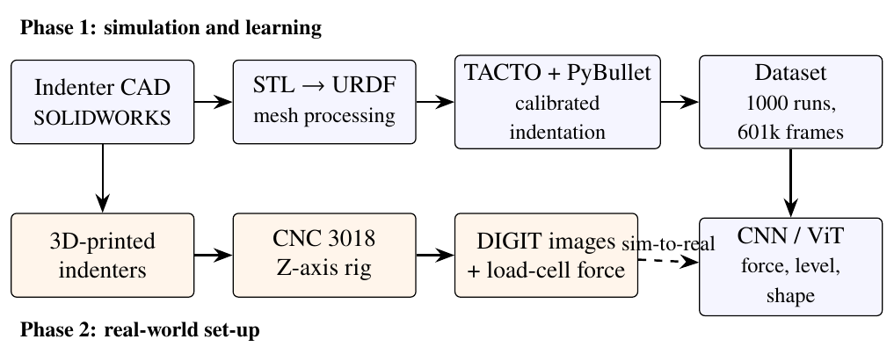

# Project overview

## Goal

Vision-based tactile sensors (VBTS) such as GelSight and DIGIT image the deformation of a soft elastomer gel with a
camera. The images are rich, but they do not directly report the contact force. This project builds a
**calibration set-up for a VBTS through machine learning**: a labelled dataset of tactile images with the exact
contact force, and deep networks that read the force, the force level and the indenter shape from a single frame.

## The two phases

### Phase 1 – Tactile sensor simulation, dataset generation and learning

1. **Indenter design.** Eight indenters with different contact geometries – asterisk, 3 × 3 ball array, hash (#),
   heart, hexagonal, ring, star and triangle – were designed in SOLIDWORKS (`cad/solidworks/`). Each has a contact
   feature, a base plate and a cylindrical mounting shank.
2. **CAD → simulation.** Each part was exported as STL (mm → m) and wrapped in a single-link URDF.
3. **Simulation.** TACTO (OpenGL renderer of the DIGIT sensor) coupled with PyBullet (physics). A per-indenter
   force–depth calibration F = φ(δ) on 0–3 mm turns a commanded force profile into a depth command
   (feed-forward depth control).
4. **Dataset.** Full factorial design: 8 indenters × 5 peak forces (1–5 N) × 5 durations (10–30 s) × 5 profiles
   (square, trapezoidal, triangular, sinusoidal, sigmoid) = **1000 runs, 601,000 frames** at 30 fps, each with the
   simulated contact force, depth, penetration and contact area.
5. **Learning.** CNN (1.21 M parameters) and ViT (2.80 M parameters) regress the force from a six-channel input
   (frame + difference to a no-contact reference). Force-level classification is derived from the regressor; a CNN
   classifier recognises the indenter shape.

Details: [phase1_simulation.md](phase1_simulation.md), [dataset_preparation.md](dataset_preparation.md).

### Phase 2 – Real-world set-up

1. **Indentation rig.** CNC 3018 frame with a stepper-driven lead-screw Z axis presses a 3D-printed indenter onto a
   real DIGIT sensor fixed on the machine bed.
2. **Indenter set.** The **hemispherical indenter is the main indenter of Phase 2** (single centred contact,
   insensitive to small tilt); the eight Phase-1 indenters are 3D-printed from the same CAD files for the real dataset.
3. **Ground truth.** A 3 kg YZC-131 bar load cell in the load path, read by an HX711 24-bit ADC and an ESP32.
4. **Recording.** `real_rig/record_both_sensors.py` records the DIGIT frames and the load-cell readings with one PC
   clock and labels every frame with the interpolated load – the same (image, force) format as the simulation.
5. **First experiment.** Real frames with the hemisphere at 0, 200 and 250 mN.

Details: [phase2_real_rig.md](phase2_real_rig.md).

## Evaluation protocols

All splits are made **by run or by indenter, never by frame** (neighbouring frames are near-duplicates).
The test indenter is the **hexagonal** indenter (the flat face with the largest saturated image signal).

| Protocol | Train | Validation | Test | Question |
|---|---|---|---|---|
| **P1 – strict unseen indenter** | 6 indenters (750 runs) | hash (125 runs) | hexagonal (125 runs) | Does the force transfer to a never-seen shape? |
| **P2 – seen indenters** | 70 % of the runs of all 8 indenters | 15 % of runs | 15 % of runs | Upper bound when the shape is known |
| **P3 – few-shot calibration** | 7 indenters (875 runs) + 5 hexagonal calibration runs (one per force level, oversampled ×10) | 5 other hexagonal runs | remaining 115 hexagonal runs | How many labelled runs does a new indenter need? |

Metrics: MAE, RMSE, bias, R² and 95th-percentile error, on all frames and on **in-contact frames** (force > 0.05 N;
about 58 % of the frames). In-contact MAE is the headline metric.

## Research questions and answers

| Question | Answer (see [experiments.md](experiments.md)) |
|---|---|
| Can a network trained in simulation read the force of an unseen indenter? | No – the image saturates at ≈ 0.5–1 N with a shape-dependent level; both networks are worse than a constant (exp000–003). |
| How good is it when the indenter is known? | 0.083 N contact MAE, R² 0.993 (exp004). |
| How much data does a new indenter need? | 5 labelled runs (one per force level): 0.096 N (exp007); one run is not enough (≈ 0.3 N, exp008/013). |
| What limits the accuracy? | Rendering noise: a 30-frame mean reference → 0.078 N (exp021), plus temporal smoothing → 0.059 N real-time, 0.043 N offline. |
| CNN or ViT? | The CNN, in every setting (ViT without pre-training: 0.30 N in exp011, 0.81 N in exp023). |
| Force level and shape? | Run-level peak force 115/115 correct; shape 99.7 % frame accuracy. |
