# Results

All numbers are on held-out test runs; "contact" = frames with force > 0.05 N. The full list of experiments is in
[experiments.md](experiments.md).

## 1. Summary

| | Contact MAE (N) | Contact R² | All-frame MAE (N) |
|---|---|---|---|
| P1 strict unseen indenter, CNN / ViT (exp000) | 2.014 / 2.721 | −1.118 / −3.500 | 1.178 / 1.586 |
| P2 seen indenters, CNN / ViT (exp004 / exp012) | 0.083 / 0.208 | 0.993 / 0.953 | 0.048 / 0.121 |
| P3 few-shot calibration, CNN (exp007) | 0.096 | 0.992 | 0.056 |
| **P3 final recipe, CNN (exp021)** | **0.078** | **0.995** | **0.046** |
| P3 final recipe, ViT (exp023) | 0.805 | 0.574 | 0.470 |
| exp021 + TTA + causal 3-frame mean (real time) | 0.059 | 0.997 | 0.035 |
| exp021 + TTA + centred 25-frame median (offline) | **0.043** | **0.9985** | **0.025** |
| Final recipe on heart (exp022), single frame / offline | 0.074 / 0.044 | 0.995 / 0.998 | 0.043 / 0.026 |

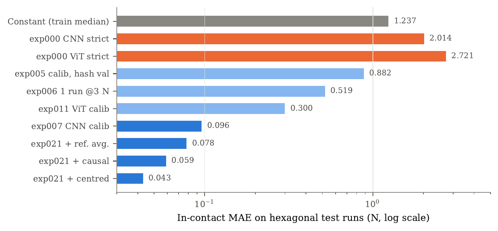

## 2. Training

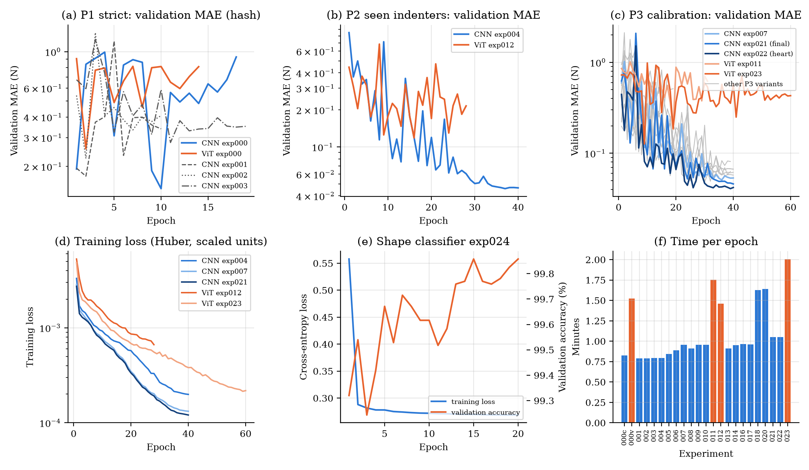

* **Strict setting (a)**: the validation MAE on the hash indenter fluctuates between ≈ 0.15 and 1.2 N without a
  downward trend; early stopping ends training after 10–19 epochs although the training loss keeps falling – the
  models fit the training indenters but do not converge on an unseen one.
* **Seen indenters (b)**: the CNN decreases steadily to ≈ 0.05 N over the 40 epochs of the one-cycle schedule; the
  ViT stops at ≈ 0.2 N.
* **Few-shot calibration (c)**: all CNN variants converge to 0.04–0.08 N on the calibration-validation runs, with large
  fluctuations while the learning rate is high and smooth convergence during the annealing phase – this is why the
  final model is kept instead of the best epoch. The ViT runs remain at 0.4–0.5 N.
* **Shape classifier (e)**: 99.3 % validation accuracy after the first epoch, ≈ 99.9 % at the end.
* **Time per epoch (f)**: CNN 0.8–1.0 min, ViT 1.5–2.0 min (RTX 5070).

## 3. Final model (exp021, CNN) on the 115 hexagonal test runs

| | n frames | MAE (N) | RMSE (N) | bias (N) | p95 abs. error (N) | R² |
|---|---|---|---|---|---|---|
| All frames | 68,515 | 0.046 | 0.083 | −0.011 | 0.196 | 0.9971 |
| In contact | 39,935 | 0.078 | 0.109 | −0.019 | 0.233 | 0.9946 |
| No contact | 28,580 | 0.002 | | | | |

In-contact MAPE 4.8 %.

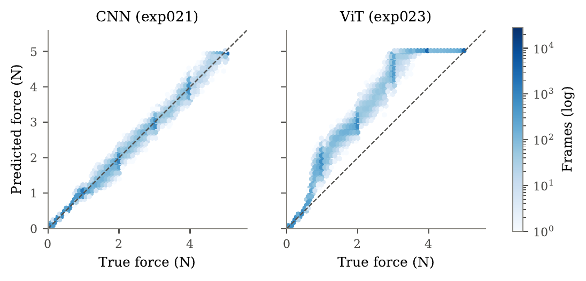

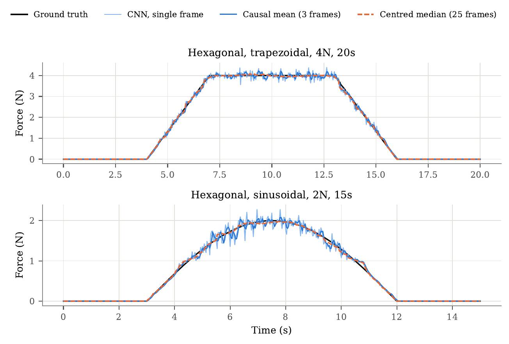

### Error analysis

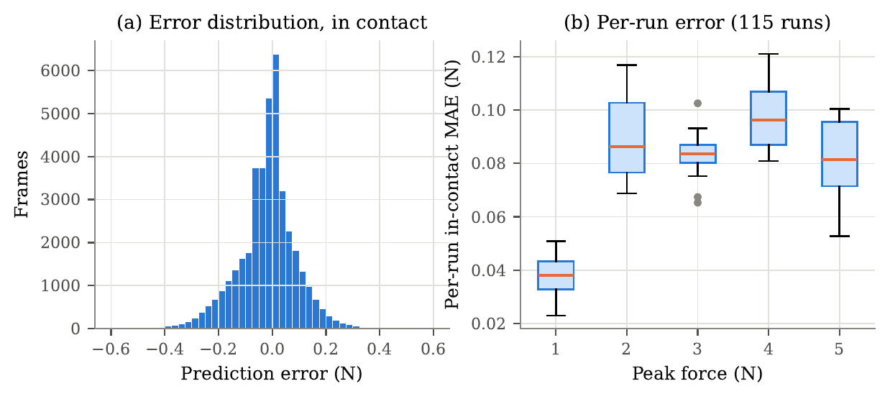

* The single-frame errors are centred at zero; 95 % are smaller than 0.23 N.
* Per run (115 runs): mean 0.078 N, median 0.083 N, max 0.121 N; the 1 N runs are the most accurate (≈ 0.04 N).

| Force bin (N) | 0.05–0.25 | 0.25–0.5 | 0.5–1 | 1–2 | 2–3 | 3–4 | 4–5.2 |
|---|---|---|---|---|---|---|---|
| In-contact MAE (N) | 0.011 | 0.016 | 0.047 | 0.111 | 0.104 | 0.105 | 0.074 |

| Phase | loading | holding | unloading |
|---|---|---|---|
| MAE (N) | 0.076 | 0.082 | 0.075 |

All-frame MAE by peak force: 1 N 0.022, 2 N 0.053, 3 N 0.050, 4 N 0.058, 5 N 0.048 N; by profile: 0.040 (sigmoid) –
0.049 N (square). The error is largest between 1 and 4 N, where the image signal saturates.

## 4. Why the strict setting fails

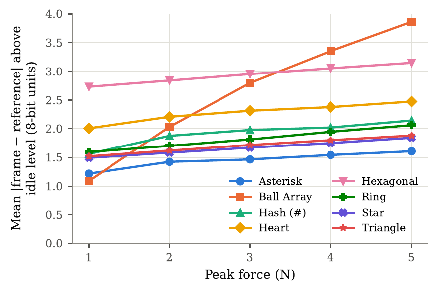

The difference image of the flat-faced indenters saturates at ≈ 0.5–1 N, and the saturation level depends on the
shape (hexagonal has the highest). A model trained on other shapes therefore maps the strong hexagonal signal to a
high force:

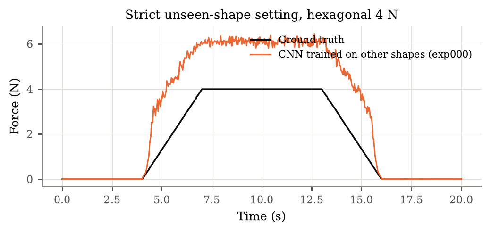

The CNN follows the timing of a 4 N trapezoidal profile but predicts ≈ 6 N during the hold.

## 5. Noise, reference averaging and temporal smoothing

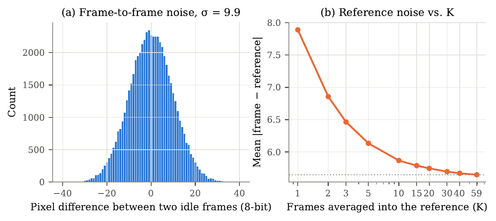

Two consecutive no-contact frames differ with a standard deviation of ≈ 9.9 grey levels (≈ 7 per frame); averaging the
reference over K idle frames lowers the mean absolute difference from 7.9 (K = 1) to ≈ 5.7 (K = 30).

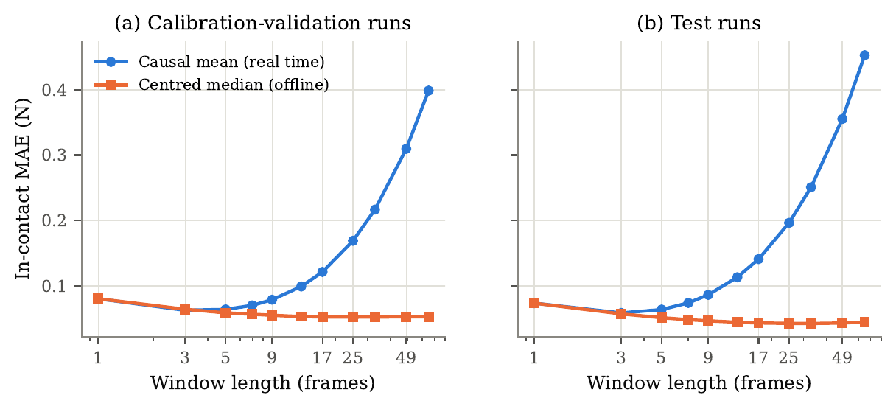

On the validation runs the causal mean is best at 3 frames (longer windows lag behind the ramps); the centred median
improves up to ≈ 25 frames and then stays flat. The test runs follow the same trend.

## 6. CNN vs ViT

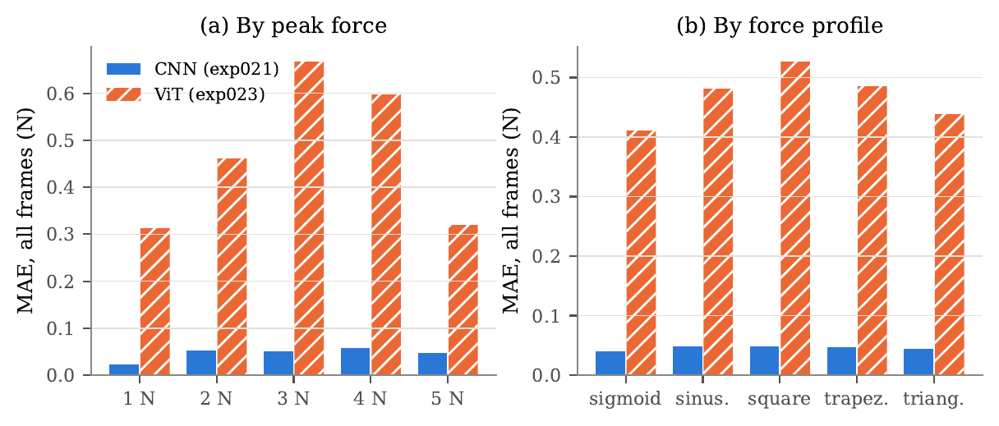

| | CNN (exp021) | ViT (exp023) |
|---|---|---|
| Parameters | 1.21 M | 2.80 M |
| Contact MAE / R² | 0.078 N / 0.995 | 0.805 N / 0.574 |
| All-frame MAE / R² | 0.046 N / 0.997 | 0.470 N / 0.772 |
| p95 abs. error (all frames) | 0.196 N | 1.458 N |
| Time per epoch | 0.8–1.0 min | 1.5–2.0 min |

The CNN error stays between 0.02 and 0.06 N for every peak force and profile; the ViT error ranges from ≈ 0.3 N to
almost 0.7 N – a systematic deficit of the ViT trained from scratch, not caused by a particular force or profile.

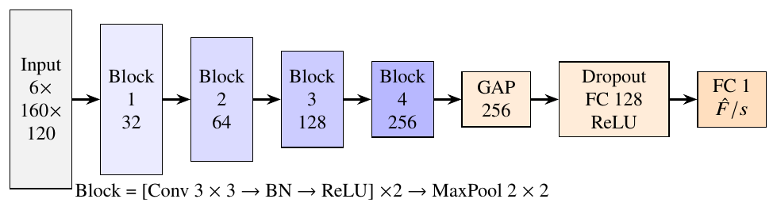

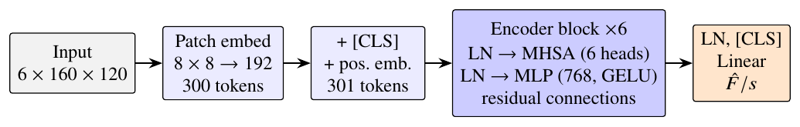

## 7. Force-level classification

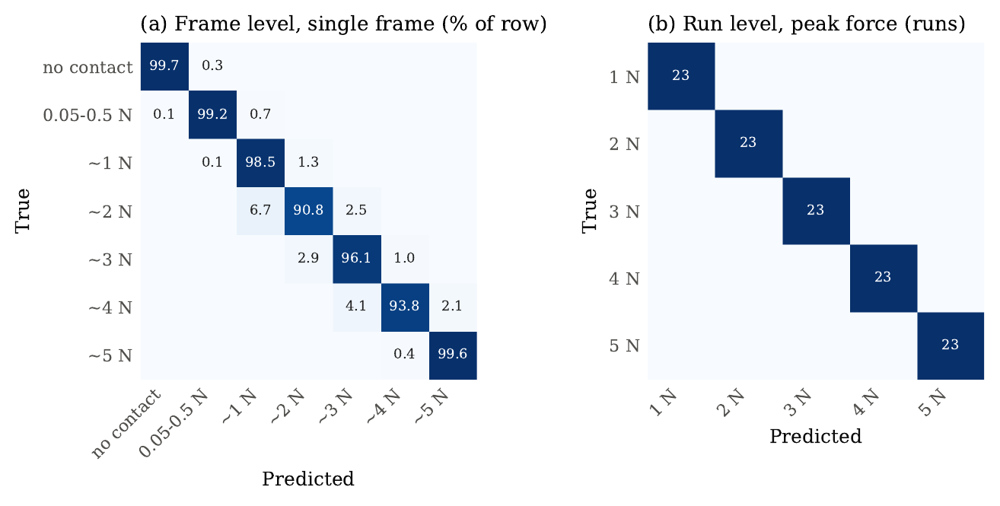

From the exp021 regressor without extra training: frame accuracy 97.6 % (98.6 % with the 25-frame median), all
errors within one neighbouring class; the largest confusion is 6.7 % of the 2 N-band frames assigned to the 1 N band.
At run level the peak force (1–5 N) of all **115/115** test runs is correct (peak-force MAE 0.055 N).

## 8. Indenter-shape classification

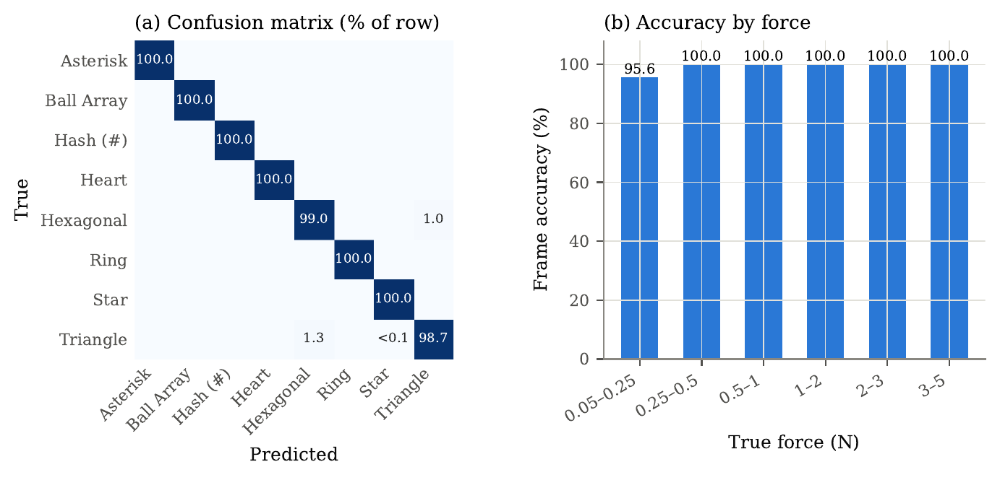

8 classes from single in-contact frames (exp024): **99.69 %** frame accuracy, macro-F1 0.997, all 152 test runs
correct by majority vote. The only errors are on hexagonal (99.0 %) and triangle (98.7 %) frames and at very light
contact (95.6 % at 0.05–0.25 N, 100 % above 0.25 N).

## 9. Phase 2 – first real frames

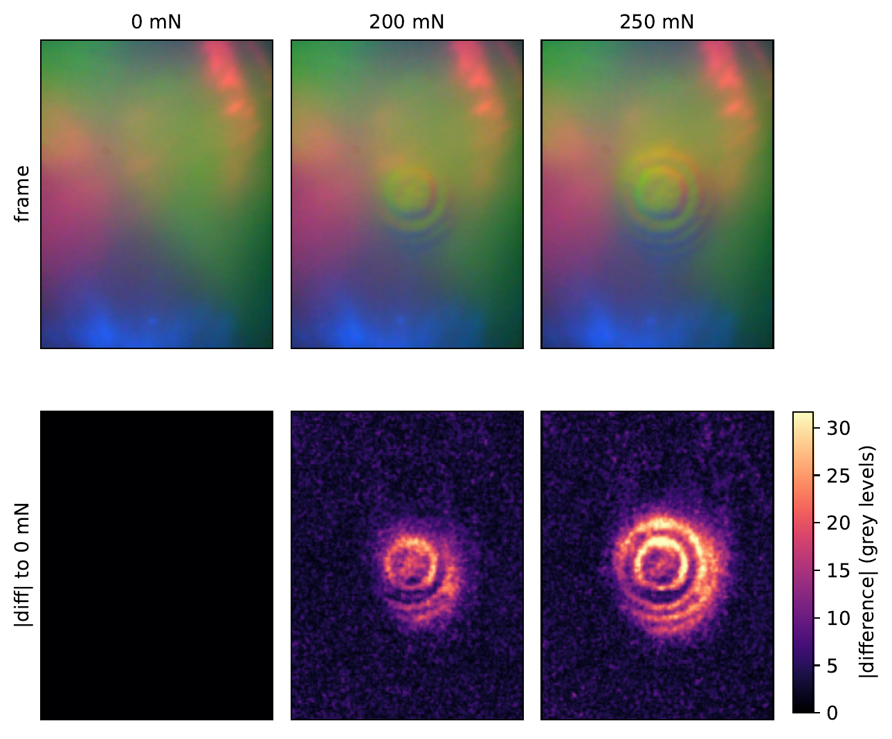

With the hemispherical main indenter at 0, 200 and 250 mN, the imprint region grows from 7,642 to 13,517 px
(equivalent radius 49 → 66 px) and the mean difference inside it from 14.2 to 17.0 grey levels; the imprint stays at
the same position. Real frames show concentric fringes instead of TACTO's smooth shading, have twice the resolution
(240 × 320) and about half the pixel noise of the simulated frames – models trained in simulation need calibration
with real data. Details: [phase2_real_rig.md](phase2_real_rig.md).

## 10. Conclusions

1. A labelled simulated tactile dataset (1000 runs, 601,000 frames) with force labels that track the commanded
   force within a few millinewtons can be produced from CAD models with TACTO/PyBullet.
2. The absolute force of a never-seen indenter cannot be read from TACTO images, because the image saturates with a
   shape-dependent level.
3. Five labelled calibration runs of a new indenter are enough to reach the accuracy of a seen indenter.
4. With a 30-frame mean reference and temporal smoothing the CNN reaches 0.059 N in real time and 0.043 N offline
   (≈ 1 % of the 5 N range); the CNN clearly outperforms a ViT trained from scratch.
5. Force level and indenter shape are recognised almost perfectly from the same input.
6. The low-cost real rig works end to end; the next step is a real dataset and sim-to-real calibration.
